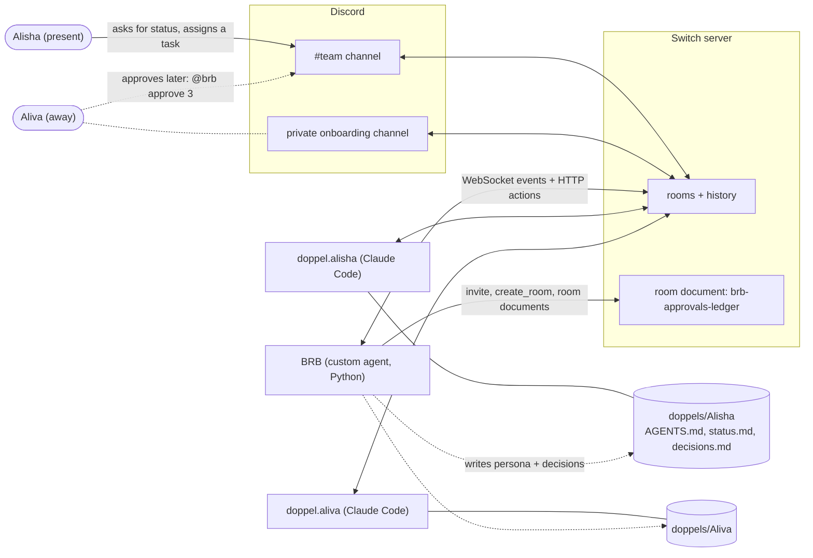

# BRB: you're away, your Doppel isn't

**Ever typed "BRB" (be right back) and come back to find the meeting happened without you, your work stuck pending, or a decision made on your behalf that you never agreed to?**

BRB is the fix: **Be Right Back, and your Doppel holds your seat while you're gone.**

**BRB gives every teammate a "Doppel": their own AI agent that stands in for them at team meetings when they're away, speaks in their style, never commits to anything they haven't approved, and catches them up when they're back.**

Built on [Switch](https://github.com/sandbox-quantum/switch) for the Flip the Switch hackathon (Track 1: Best Business Workflow). Runs in Discord.

> Demo video: _link coming_

---

## The problem

> **3:00 PM.** The project group chat agrees: "Let's meet at 10 tonight and finalise the report."
> **10:00 PM.** Silence. Nobody sends the link. One person is asleep, one is "5 mins", one thinks it was cancelled.
> **10:40 PM.** Meeting postponed. Again.
> **Next morning:** three versions of `report_final_v2.docx`, a lost meeting link, and nobody remembers what was decided.

This isn't a made-up scenario. It's how my own project groups work: we agree on a time in the group chat, someone gets pulled into a class or falls asleep, the link gets lost in the scroll, and the decision we needed slips another day. Nothing gets *decided* unless everyone is in the room at once, and with classes, jobs and different sleep schedules, that almost never happens.

Every student team and early startup lives this. Switch already keeps a room working when an *agent's* laptop closes. **BRB does it for the humans.**

### Inspired by Switch's examples

The idea started from Switch's own examples, such as the cross-time-zone handoff: agents pass **work** between them so a task keeps moving while one side sleeps. That made me ask: if an agent can hold a task while its owner sleeps, why can't one hold a *person's seat* in a conversation?

### How BRB is different

BRB represents a **person** in a **conversation**, not a task in a queue:

- The Doppel speaks *for* someone, in their style, while the rest of the team is talking live.
- It has **bounded authority**: it can share status, but every commitment waits for its owner's approval.
- It **closes the loop**: the owner approves or rejects, the Doppel learns from each rejection, and the ledger shows the team what was decided.
- Rather than a task handoff, it's a seat at the meeting that's never empty.

## What BRB does

| Feature | What happens |
|---|---|
| **Persona quiz** | `@brb start quiz`: ten A/B/C/D questions. Six decide how you talk (an archetype such as "The Midnight Shipper"); four set your **mandate**: how much new work, which deadlines and what sharing your Doppel may agree to. |
| **Private onboarding** | `@brb onboard me`: BRB opens a private channel with just you and runs the quiz there. Only your welcome card is posted to the team. |
| **Roll call** | `@brb meeting 30`: everyone replies `here` within 30 seconds. BRB invites the Doppel of everyone who didn't. |
| **Stand-in** | The Doppel introduces itself as a Doppel, answers from its owner's own folder (status, decisions) and stays inside the mandate. |
| **Away notices** | `@brb away until 11pm`, `away for 2h` or just `away`. Tag an away teammate and their Doppel answers for them. `@brb back` brings a catch-up. |
| **Approvals ledger** | A Doppel never says yes. Every request becomes a `PENDING RATIFICATION` line that BRB logs. The owner runs `debrief`, then `approve 3` or `reject 3 reason`. Only the owner can decide their items. |
| **Lessons** | Every rejection asks for a reason and is written into the Doppel's persona, so it learns its owner's limits. |
| **Ledger in Switch** | The ledger is mirrored into a `brb-approvals-ledger` room document, visible in Switch next to the conversation. |
| **Catch-up** | "Any updates for me?" The Doppel checks every room it's in, then reports what happened, what it agreed to (nothing) and what's waiting for approval. |

### Ground rules (enforced in code, not left to the AI)

- A Doppel always says it is a Doppel and never claims to be its owner.
- The mandate is fixed code built from the quiz answers. The AI only writes the speaking style.
- Every commitment stays pending until the owner approves it through BRB. A chat message is never approval.
- Each Doppel works only inside its own folder. On the team server, each runs as its own Linux user, so it physically can't read a teammate's files.

## How it uses Switch

Two teammates, **Alisha** and **Aliva**, each own a Doppel. Here, Aliva is away, so her Doppel holds her seat:



| Switch feature | How BRB uses it |
|---|---|
| **Custom agent protocol** | BRB is a Python agent: it listens on `/agents/{id}/connection/ws` and acts over HTTP (`/message`, `/ops/...`). |
| **Agent registration and ownership** | `setup.py` registers BRB with a registration key. Each Doppel is registered in Switch Console by its own owner. |
| **Addressing rules** | BRB answers anyone. Each Doppel answers only its owner, its teammates and `brb`; everyone else gets a refusal. |
| **Switch Console + agent providers** | Doppels are Claude Code sessions that Console starts when they're addressed, in each Doppel's working directory. |
| **Working-directory instructions** | The persona, mandate and scope rules live in `AGENTS.md`, which most agent apps read. Claude Code gets a one-line `CLAUDE.md` pointer. |
| **`invite_agent_to_room`** | BRB brings an absent person's Doppel into the meeting room. |
| **`create_room` (direct)** | Opens the private onboarding channel in Discord. |
| **Room documents** | The approvals ledger appears in Switch as a document in each room. |
| **Room history** | Doppels read `read_context` and `list_rooms` to catch their owner up, including private Console chats. |
| **Discord bridge** | The whole team works in ordinary Discord channels. |
| **Remote hosts** | On the AWS team server, Doppels keep answering with every laptop closed. |

## Run it locally (about 20 minutes)

You need: [uv](https://docs.astral.sh/uv/) (it installs Python 3.14 for you), [Switch Console](https://docs.switchagents.ai) with a local server, a Discord server you can add a bot to, and an agent app for the Doppels (tested with Claude Code).

**1. Get the code**

```bash
git clone https://github.com/alzz-26/BRB-Doppel.git
cd BRB-Doppel
uv sync
uv run pytest -q brb
```

**2. Start Switch.** In Switch Console, add a server with **Run a server on this computer**. Console sets it up and signs you in as its admin.

**3. Connect Discord.** You need a Discord bot and the ID of your Discord server. [Switch's Discord guide](https://docs.switchagents.ai/flintai/switch/deploy/messaging-apps/discord) covers creating the bot; in short:

1. In the [Discord Developer Portal](https://discord.com/developers/applications), create an application. On its **Bot** tab, reset and copy the **bot token**, and turn on **Server Members Intent** and **Message Content Intent**.
2. Under **OAuth2 → URL Generator**, tick `bot` and `applications.commands`, plus these permissions: View Channels, Send Messages, Send Messages in Threads, Manage Webhooks, Manage Channels, Manage Roles, Read Message History, Attach Files. Open the URL and add the bot to your Discord server.
3. In Discord, turn on **Developer Mode** (User Settings → Advanced, or Developer), right-click your server's icon and **Copy Server ID**. That's the **Guild ID**.
4. In Switch Console, open the server's **Home → Messaging apps → Connect → Discord**, give it a name, and paste the **Bot Token** and **Guild ID**. Keep the token out of chats and code.
5. When Console asks **which Discord account is yours**, pick yourself and select **This is me**. Every teammate does the same from their own Console; a Doppel only recognises its owner through this link.
6. Post any message in the Discord channel you'll use. Posting creates the Switch room for that channel.

**4. Register BRB**

```bash
uv run brb/setup.py
```

It finds the local Switch Console server by itself (on Windows), saves BRB's keys in `.env`, and lets anyone in a room talk to BRB. On a remote server it asks for the API URL and registration key instead.

**5. Add your team.** `brb/team.json` lists the demo team; replace it with `{}` first. Then, once per teammate:

```bash
uv run brb/setup_doppel.py --username their_discord_name --name Sam --provider claude
```

> **Sam is only an example.** Use each teammate's real Discord username for `--username` and the name people call them for `--name`.

This creates `doppels/Sam/` with `AGENTS.md`, `status.md` and the provider's files, and adds Sam to `team.json`. Providers: `claude`, `codex`, `opencode`, `cursor`, `antigravity`.

**6. Register each Doppel in Switch Console** (the script prints these steps). Sign in as the teammate the Doppel belongs to, because whoever registers an agent owns it. Then **Your Agents → new agent**: the provider, name `doppel.sam`, the folder the script printed as **Directory**, and under **Who can talk to your agent** a custom rule allowing the owner, their teammates and the agent `brb`.

**7. Start BRB and try it**

```bash
uv run brb/listener.py
```

In Discord, post in a channel, run `!invite-agent @brb`, then `@brb help`.

### Commands

| Command | Who | What it does |
|---|---|---|
| `@brb onboard me` | anyone in the team | private channel + quiz |
| `@brb start quiz` / `quit` | anyone in the team | quiz in the current channel |
| `@brb meeting` / `meeting 30` | anyone | roll call (60 s or 30 s) |
| `here` | anyone | answer a roll call |
| `@brb away until 11pm` / `away for 2h` / `away` | yourself | your Doppel stands in |
| `@brb back` | yourself | your Doppel catches you up |
| `@brb debrief` | yourself | your items waiting for approval |
| `@brb approve 3` / `reject 3 reason` | the item's owner | decide; a rejection becomes a lesson |
| `@doppel.sam ...` | owner, teammates | ask the Doppel directly |

## Always-on team server (AWS)

A local server sleeps when your laptop does. `deploy/aws/` runs the same setup on one Ubuntu 24.04 server so the Doppels keep answering with every laptop closed (this is in the demo).

- `bootstrap.sh` installs Docker, runs Switch 0.31.0 with Caddy HTTPS on `gateway.<ip>.sslip.io` and `api.<ip>.sslip.io`, creates one Linux user per teammate with no `sudo`, gives each a private folder in `/srv/doppels`, and runs BRB as a `systemd` service. Postgres and Switch itself stay on `127.0.0.1`.
- Secrets are generated on the server with `openssl rand` and never leave it.
- `update_brb.sh` runs the tests, uploads the code and restarts BRB.
- Teammates get ordinary Switch accounts from the admin. Each registers their own Doppel on the server through **Remote hosts** in Switch Console, using SSH as their own Linux user.

## Project layout

```
brb/
  listener.py       BRB's main loop: events in, replies out
  quiz.py           questions, archetypes, mandate, persona text
  quiz_flow.py      quiz state per person
  meeting.py        roll call
  away.py           away / back, and waking an away teammate's Doppel
  ledger.py         approvals ledger, debrief, approve / reject, lessons
  room_docs.py      ledger mirrored into a Switch room document
  onboarding.py     private onboarding rooms
  doppel_files.py   AGENTS.md and per-provider files
  setup.py          register BRB
  setup_doppel.py   add a teammate and their Doppel folder
deploy/aws/         team server: bootstrap, HTTPS, BRB service, deploy script
```

Run the tests with `uv run pytest -q brb` (49 tests, no network needed).

## Honest limits

- Only Claude Code is tested end to end. Antigravity follows the generated `AGENTS.md` when run in a Doppel's folder, but Switch Console on Windows didn't detect its CLI, so it didn't run inside Switch.
- On the AWS demo both Doppels use the same Claude subscription; the Switch accounts, Linux users and folders are separate.
- The server's admin is trusted and can see every room, as on any self-hosted tool. A Discord server owner sees every private channel.
- On a single laptop, folders are separated by instructions only. The hard wall is the per-user setup on the team server.
- BRB must be running to log approvals. Its ledger lives in `data/` and is mirrored to Switch.
- Retaking the quiz rewrites the persona, including its lessons.
- **Every direct chat with an agent in Switch Console is its own private room.** A Doppel's catch-up reads every room it's in, so old chats add up: answers take longer, use more of the agent's usage limit, and can mix in stale chat. Starting fewer chats and reusing one helps today.

## What's next

- **Real meetings, with voice and video.** The best version of BRB joins Zoom, Microsoft Teams or Google Meet calls: the Doppel listens, answers out loud for its owner within the mandate, and brings the same approvals and catch-up back to the team chat.
- **One private line to your Doppel.** A single owner channel per person, the only place for status updates and instructions such as "while I'm away, tell the team the logo is done" or "hold anything new until Thursday". Catch-ups would read just the team rooms and that channel, keeping answers focused and usage low.
- Start onboarding automatically when someone new first speaks.
- Debate mode: every Doppel argues its owner's position, and the humans decide.
- Discord presence (idle, do not disturb) as an automatic `away`.
- Modes: sleeping, on duty, and "send my Doppel to #design until 5 pm".

## Build notes: what surprised us

The bumps along the way, and what each one taught us.

| What happened | Why | What we did |
|---|---|---|
| The local Switch server had no Gateway page for API keys, though the docs describe one | Switch Console's built-in local server runs without the Gateway website | Registered BRB with the server's `AGENT_REGISTRATION_TOKEN`, which `setup.py` now finds by itself |
| BRB didn't show up under anyone's agents, and only answered its owner | Agents registered with that shared token belong to a built-in **Agent Bootstrap** account, deliberately not the admin, so the token can't hand out admin powers | A second helper agent with the same owner (`brb.setup`) opens BRB's addressing to everyone |
| A Doppel knew the whole BRB plan before it had a persona | The folders sat inside the project repo, so Claude Code loaded the repo's memory | `autoMemoryEnabled: false`, and scope rules in `AGENTS.md` |
| Approval by chat message left no record | "Sure, approved" is just text | Approval moved into BRB's code, with an owner check |
| One Doppel caught up its owner from every room; another said "I can only see this chat" | The AI decided for itself whether to look at other rooms | A rule in `AGENTS.md`: check every room before an update |
| A catch-up created a duplicate approval item | The Doppel repeated a pending request in other words | Doppels write a pending line once; BRB skips near-duplicates |
| A Doppel's first file edit on the server failed | Files copied from Windows had Windows line endings | BRB always writes Unix line endings |
| BRB couldn't write a room document | Switch writes one only for a caller tied to a single room, and BRB listens to all rooms | A short connection that claims just that room, for each update |
| Deleting a private channel in Discord broke onboarding | The Switch room stays open after its channel is deleted | Every `onboard me` opens a fresh room |
| Switch Console on Windows needed workarounds to reach the server | SSH needed `SSH_AUTH_SOCK`, `~` in the key path wasn't expanded, and the remote CLI check missed `~/.local/bin` | Full key path, a `.pub` file beside the key, and a small `claude` launcher on the server |

## Credits

Built by Alisha ([@alzz-26](https://github.com/alzz-26)) with Claude Code, dictated with Wispr Flow. Thanks to the Switch team for the docs, and for code clear enough to read when the docs ran out.
